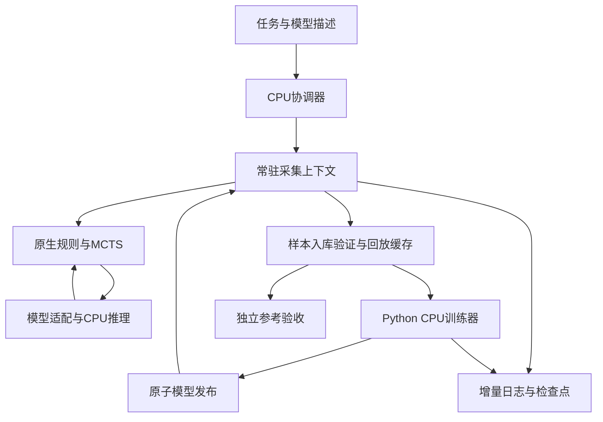
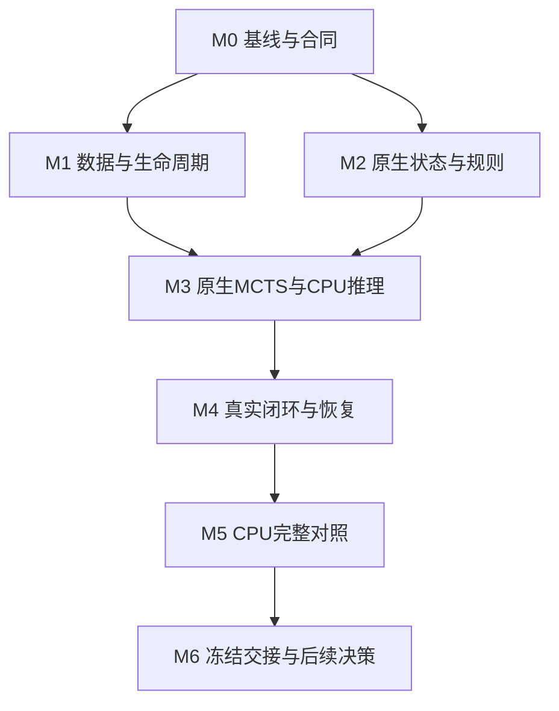

# 魔塔AI CPU优先高吞吐运行时：架构与项目书 v0.1

日期：2026-10-22（北京时间）  
状态：外部评审草案；评审回收后修订并冻结，才作为Codex实施依据。  
范围：Codex本地CPU工程优化、必要的短真实训练闭环验收。GPU后端仅定义接口，不实施云端部署和GPU实验。

## 1. 决策摘要

我们采用AlphaZero式的“策略/价值网络引导MCTS→真实游戏交互→经验回放→SGD→模型发布→后续采集使用新模型”。本轮目标是减少完成同等学习工作的工程成本，让日常Codex任务首先受益。

建议建设CPU优先的高吞吐运行时：紧凑状态与规则、原生MCTS、常驻CPU推理、一次验证与编码的回放数据、增量持久化、统一协调与账本。Python保留训练和管理，原参考引擎保留为独立认证依据。

本项目综合了Claude、Qwen两份独立工程评审；不是任何一份报告的原样实施。综合判断如下：

| 来源/复核 | 采用的内容 | 本计划的修正 |
|---|---|---|
| Claude评审 | 执行体系可以整体重构；采集、推理、训练、存储应分工 | 不接受“唯一技术路径”或“原结构上限10倍”为已证明结论；GPU与异步不是CPU阶段前提 |
| Qwen评审 | 紧凑状态与传输、原生规则和搜索、回放缓存、完整成本核算、小批推理实测 | 首期专注CPU；不把四局物理屏障与每动作完整存盘冻结为永久架构 |
| 项目源码复核 | 反复验证全历史、重复编码、重复构造Runner/模型/优化器及大量数据物化 | 先消除重复工作，再衡量并发；已有进程池和COW不能作为新增成果重复申报 |
| 新离线检查 | 无损紧凑观测可行；孤立C++函数容易被Python边界吃掉收益；缓存组批有效 | 检查只覆盖已有记录和局部路径，未构成完整引擎认证，也不是整链加速证据 |

两份原报告未在本目录全文重发。上述是综合摘要；源码事实以公开固定资料和实际代码为准。外部评审应独立质疑本计划，不能把两位AI的意见数量视为技术正确性证明。

## 2. 背景与当前状态

魔塔是确定性的单人资源规划游戏。对象交互顺序影响HP、攻防、钥匙及未来可达性。策略动作是对象交互；不能把普通移动格当作新的策略选择来悄悄改变任务。单人MCTS价值回传不逐层变号。

P48已跑通AutoDL上的完整训练闭环，工程组合两组外层吞吐约提高2.1倍；没有证明模型能力提升。历史各窗口中的失败终局也必须作为真实数据保留，不能因未通关从产能统计中删除。

P49及P49.5的小塔实验已提供闭环与部分迭代收益证据。该小塔学习研究暂时收束；本项目不扩大地图、不重新评选地图CNN与对象拓扑网络、不重新运行多轮学习研究。必要的SGD和新模型回流只用于工程验收。

用户希望日常Codex CPU任务先提速，之后再把优化成果迁移到带GPU的电脑。CPU阶段不依赖AutoDL、CUDA、远程部署凭据或GPU设备。

## 3. 事实、估计与尚未验证事项

### 3.1 已有实测事实

历史性能锚点为P48 probe2，见公开[BASELINE.md](../../review/20261022/BASELINE.md)：

| 项目 | 原基线 | 已有CPU工程候选 |
|---|---:|---:|
| 已提交合格新位置 | 1932 | 4225 |
| 外层墙钟/秒 | 619.220 | 642.755 |
| 合格新位置/秒 | 3.120 | 6.573 |
| 相对原基线 | 1 | 2.1068 |
| 模型更新 | 3 | 7 |
| SGD步数 | 208 | 486 |

历史资源记录为约20核CPU配额、约90GiB内存，机器可见208逻辑CPU不等于可使用208核。该胜出组合主要使用CPU，4090不是这2.1倍收益的来源。另一组重复约2.058倍。

历史基线互斥桶包括规则127.914秒、编码97.828秒、观测哈希41.640秒、network forward 135.924秒、保存other 82.132秒等。嵌套的检查点和训练采样计时不得再加一遍；父侧future等待也不能全部叫IPC开销。

### 3.2 设计前离线检查，仅作启发

| 检查 | 观察 | 限制 |
|---|---|---|
| 紧凑输入还原 | 本地早期P48归档1980个位置，与原观测哈希全部一致；371800字节观测可表达为约2708字节包 | 不是probe2的1932位置；不是全部事件/搜索节点认证；不是完整规则状态身份 |
| 原生BFS | 同批记录27140条前沿路径及顺序一致；核心约7.7倍；加回Python路径列表约1.2倍 | 未迁移完整规则、战斗、事件、MCTS；临时打包还可能更慢 |
| 回放输入缓存 | 128位置、固定20批×64索引，输入逐字节一致；局部组批约25.6倍 | 不含解析、目标、SGD、设备传输；不是完整回放或端到端倍率 |

这些脚本和运行记录尚未作为本公开目录的正式可复现工件发布。本项目不能凭此判定任何里程碑PASS；M0应决定是否把其中必要检查正式纳入新证据盒，避免重复无意义探测。

### 3.3 规划估计

相对同资源、同学习工作量的原始串行实现，CPU阶段规划区间10—30倍，中心约20倍；GPU阶段未来再争取累计约30—70倍，中心约50倍，最终冲击100倍。均为主观规划，不是实测、置信区间或永久上限。

CPU结果受核配额、内存、网络结构、批量和实际任务影响。P49小图网络与P48十层CNN的瓶颈不同，不保证享有相同倍率。

## 4. 本轮目标、范围和边界

### 4.1 交付目标

交付一套在无GPU的Codex CPU环境中可构建、运行、恢复、比较的新运行时，并证明：

1. 正确执行真实规则、合法动作和终止条件。
2. 每个训练决策真实完成规定的100次新增模拟，保留树复用及账本语义。
3. 真实采集、到期SGD、发布、后续采集消费新权重全部接通。
4. 通过同现场配对实测，给出完整闭环产能及单位CPU成本的变化。
5. 当前对象拓扑模型能够通过独立适配器接入，运行时不写死地图CNN。
6. 为未来GPU后端保留明确接口，迁移无需重写游戏、搜索和数据账本。

### 4.2 本轮不包含的工作

本轮不启动GPU/AutoDL实验、远程部署、购买设备、修改地图难度、改变网络容量、研究新奖励或采样算法、注入路线答案、重跑P49/P49.5多种子学习比较，也不要求新一轮棋类系统文献研究。

本文件与里程碑是实施设计；本次文档发布不授权自动执行所有后续任务。用户按里程碑启动Codex任务，每次明确预算和前置提交。

## 5. 测试轨与公平对照

### 5.1 三个分母分开

- H48：历史AutoDL P48原基线，1932/619.220。用于历史桥接和100倍长期目标。
- C0：本轮Codex CPU现场运行原参考实现所得的新基线。**CPU阶段正式倍率使用它**。
- Cbest：同现场可用的已有CPU优化组合。新版本同时报告相对C0和相对Cbest的收益，避免掩盖已完成的2.1倍工程成果。

`speedup_cpu = rate_new_on_Codex / rate_C0_on_same_Codex`

不能把Codex新速率直接除以历史AutoDL速率，称作严格CPU加速结果。若历史可执行模型/权重不全，用共同随机初始化的新配对run，明确其不是历史训练复现。

### 5.2 两条兼容轨，各司其职

| 轨道 | 用途 | 输入与规则 |
|---|---|---|
| R48性能参照 | 成本分解、与公开P48代码桥接、完整CPU对照 | 沿用冻结十层规则和原网络；550×13×13、713动作仅为该适配器的旧接口 |
| T49对象拓扑接入 | 保证本框架服务当前拓扑方向 | 直接输入对象节点、关系和勇士状态，保留该模型原参数/训练配方；不转成二维网格送给CNN |

公开已有`tasks/tower10/p49/topology/`和`controlled/`可作为T49接口检查来源。P49.5最新版本是否可作为实施基准，应在M0实际读取源码、核对身份后决定；不能依据私有报告链接声称已取得源码。若最新版本未公开，外部评审可评公开适配边界，实施由有权限的Codex在私有工程读取，未经新授权不追加公开其内容。

R48的内部历史图可用CSR保存，保留原路径/事件语义；这不等于把该格点图规定为新业务的网络输入。T49对象图保持原生对象关系，搜索执行不回到地图寻路。两者共享接口和基础设施，不强迫共用同一编码器。

T49首期只做必要的短闭环兼容验收，不承担另一轮架构优劣研究。若两轨工作量过大，外部评审应提出明确的缩减方案，优先保证对象拓扑主线不会被参考基准替换。

## 6. 总体架构

未来GPU后端替换E及G的设备实现，规则、搜索和数据协议继续复用。图中环表示数据与模型流，首期不要求异步采集与训练同时运行。

### 6.1 原生状态与规则

静态地图/对象定义、战斗规则、事件程序和关系索引在启动时装载一次，并绑定内容身份。动态状态以紧凑结构保存英雄资源、对象状态、事件标志、障碍、商店计数和影响规则的历史信息。

优先实现可验证的连续结构和紧凑状态复制；只有CPU剖析证实状态复制仍重要时，才引入make/unmake与复杂撤销栈。不能为了模仿棋类系统而提前承担不必要的恢复复杂度。

原规则中有门钥匙、特殊战斗、商店、trader、spawn、ambush、automatic、方向、跨楼、noPass和Goal。必须逐项认证。走廊可以编译为索引或微程序，但不能删除途中自动事件及顺序。状态存在变化时，不能缓存一个永远有效的“固定可达图”。

搜索内部避免构造给人类展示的完整路线列表、JSON事务证明和冗余delta；真实动作边界与验收器仍能生成需要的Route/路径和结算证据。规则所需的路径结算计算不能因不输出路线而省略。

### 6.2 原生搜索

状态、树、边N/W、合法集和访问计数一起驻留。一个真实决策的100次模拟连续推进，只在叶节点评估时交换紧凑请求。禁止每次模拟把完整Python世界来回转译。

首先保持单树串行PUCT，跨独立局并行；不在首期加入virtual loss或同树批内扩展。节点访问统计仍是树统计，不能把不同路径的N/W合并成状态DAG冒充无损缓存。

必须保留单人同号回传、unvisited Q、cpuct、根噪声、温度/采样窗口、动作顺序、同模型子树复用、继承访问与100次新增预算的实际语义。

### 6.3 CPU推理与模型适配

首期使用常驻PyTorch CPU模型；是否进一步使用导出模型或原生低延迟后端，由新测量决定，不预先承诺第三方后端一定更快。不得每局反复创建同一模型、优化器并装载同一权重。

模型接口通过ModelSpec描述节点/关系/英雄张量或旧参照张量、dtype、动作映射、schema身份。支持变长节点和mask，不在公共核心写死21、326、550或713。

紧凑传输只改变工程表达，不改变当前网络看见的信息。对象图模型直接消费对象图张量。旧CNN适配器可在推理边界还原其原始观测；这一旧参照行为必须清楚标注。

先测batch1/2/4与实际可供给并发。不要为凑大batch长时间等待，也不要照抄棋类系统的大批量。服务应有最大排队时限、背压、超时错误和关闭排空。进程内直接调用与常驻共享服务比较择优；CPU阶段不强制增加RPC层。

### 6.4 数据与训练

样本成为正式回放条目前，完成规则/终局/标签与来源验证；之后以不可变身份复用。缓存观测、合法mask、pi、z及训练所需字段。回放窗口淘汰后，昂贵特征缓存可释放，审计元数据和对局工件继续保留。

训练仍按原来的抽样索引和配方执行。首期保持uniform with replacement、batch、优化器、动量、L2施加范围、BN行为、学习率和训练触发规则。缓存不能改成“优先抽容易缓存的样本”。

P48 full dense replay约2.84GiB只是设计参考。M0测实际Codex配额后，冻结缓存上限和LRU/内存映射策略，给模型、采集树和系统留余量。不能无视低内存Codex直接分配历史90GiB。

### 6.5 协调、并发与模型发布

首期保留逻辑训练节奏，去掉不必要的物理等待和对象重建。在同模型独立对局间分配工作，避免嵌套线程过量：actor数×推理线程数加训练/验证线程不得盲目超过CPU配额。

初版先采用同代屏障，训练期间暂停该链采集。较多actor、预取或异步可以作为后续候选；改变样本提交顺序、触发批量、模型滞后时按行为变更另列，不能合并进严格对照收益。

模型发布先完成持久化和身份校验，再原子切换model_id。每个请求、样本和回复绑定模型版本；旧回复不能写入新模型树。若跨代切换，清除不兼容树与权重相关缓存。最终验收必须有新模型发布后真实采集消费的记录。

### 6.6 持久化和验证分工

不变模型以内容寻址文件保存，检查点引用它；增量日志保存新增样本、树/决策进度、训练进度和发布事件。周期检查点保存恢复所需模型、优化器、BN、RNG及运行状态。

CPU主对照优先保留既有持久提交边界，用较小日志替换重复全量保存。若拟将恢复窗口改为每轮或定时保存，需在M0/M1提前冻结最大可丢失的未提交工作及重算办法，作为独立配置报告；不能在跑完后隐去这一条件变化。

已提交样本不得丢失或重复计数；崩溃后的重复执行不得计作新的学习工作。训练从检查点后重放时，必须使用记录的抽样/RNG和步数账本，避免跳过或重复提交SGD。

验证分成：开发期差分、入库首次完整验证、运行期轻量守恒检查、独立最终审计。不能删验证来伪造提速；也不应在每次训练反复验证不变的全历史。首次验证结果与schema/规则/验证器版本绑定；任何内容变化使缓存失效。

## 7. 核心接口与身份

以下为接口合同，不要求语言绑定逐字采用这些函数名。

| 接口 | 输入 | 输出与不变量 |
|---|---|---|
| TaskSpec/ModelSpec | 地图/规则、动作、模型/观测描述 | 静态与规则身份、schema、类型/维度、资源边界 |
| StateStore | 紧凑完整动态状态 | 支持复制/恢复；不丢失规则读取的历史字段 |
| legal/step/terminal | state、action_id | 完整合法集；精确结算；Goal后0动作 |
| SearchContext | state、模型身份、RNG、搜索配置 | 真实100新增模拟、N/W、pi、所选动作、继承统计 |
| EvalRequest/Reply | request_id、model_id、schema、紧凑观测 | 原始logits/value；回复与请求严格绑定 |
| ReplayStore | 已验收episode及样本条目 | 稳定sample_id、原抽样索引、窗口、不可变内容身份 |
| Learner | 指定抽样索引和目标、父模型 | 到期/已完成SGD账本、优化器/BN/RNG、新模型 |
| Publisher | 完整训练与模型工件 | 原子发布、模型hash、实际后续消费证据 |
| RecoveryStore | 日志、检查点、已提交边界 | 无丢失已提交项、无重复计数、明确未提交损失窗口 |
| ReferenceVerifier | 状态/交互/样本、版本身份 | 独立合法集/结算/标签验证，不能复用同一新实现作真值 |

规则状态身份、网络输入身份、模型身份不能混用。两个世界可有相同网络观测但后续规则不同，不能因此合并规则状态。快速hash只能作为索引；生产缓存需完整键比较或明确的碰撞校验机制，不能用属性分桶制造近似相等。

缓存至少绑定模型版本（如与权重有关）、schema、规则/资产版本和完整相关输入。不能把64位Zobrist当作独立认证证明，不能声称SHA256支持通用O(1)增量更新。

新实现拥有新的engine/source身份，保留父来源和兼容性关系。不得删除旧源码hash检查后仍声称运行的是冻结参考实现。旧引擎在独立位置保持原样，用于差分与回滚。

## 8. 正确性与变更管理

### 8.1 首期保持的学习合同

真实规则、完整合法集、战损、自动事件、任务终止、奖励、每决策新增模拟预算、树复用、样本定义、回放抽样、到期训练量及模型真实回流保持。

P48参照配置为100新增模拟、cpuct1.25、根Dirichlet alpha0.3/mix0.25、前30交互采样、replay8192、512新位置触发、batch64、8次曝光、SGD lr0.01/momentum0.9、Conv/Linear权重L2系数1e-4。每次实际触发n条新位置，欠账为ceil(8*n/64)步；不能把未达触发阈值的尾部样本硬算成已到期债务，也不能漏掉已经触发的训练。

P49/T49沿用其自身冻结配方，不强行套P48触发阈值。评价入口历史上可能另有800模拟；本轮工程采集100模拟与评价预算必须分别标注，禁止误触默认800评价路径。

### 8.2 分层门禁

1. 规则层：整数资源、对象/flags/task、合法动作集合与顺序、拒绝理由、终止状态精确一致。
2. 编码层：保持dtype/shape/动作映射；无损编码对应字节与身份一致。对象图排列变化需明确同步重排特征、关系、mask与logits，不能把新排序当作无损改造而不验证。
3. 搜索层：用相同预归一化先验/价值oracle、根噪声、RNG状态，比较扩展/选择顺序、N/W、继承N、新增预算与pi。禁止编译fast-math偷偷改变比较语义。
4. 网络层：同后端原样调用要求一致；更换计算后端预注册数值容差，建议起点abs1e-5/rel1e-4，按logits/value及更新后的权重、BN、优化器分别评估。接近并列的动作分叉单列，规则差异不适用浮点容差。
5. 学习层：同batch索引、mask/pi/z、损失项和应做SGD对照，验证有效梯度、参数变化及后续消费。仅接口通过不等于学习收益提升。

调整actor数不一定保持相同随机样本流；异步、模型滞后、精度和同树并行必须独立标注。显式工程取舍可以研究，不能悄悄混入同工作量等行为对照。

## 9. 收益预算与最可能失败的假设

### 9.1 CPU工作量模型

设每位置的CPU工作量为c_cpu，实际可用并行能力为C_eff，训练/存盘/协调占用及尾部造成的有效采集比例为d。CPU吞吐近似受`C_eff / c_cpu`、单局推理依赖、训练供给和持久化速度共同限制，不能把actor数与已经包含它的平均使用核数再乘一遍。

旧P48原基线平均CPU约1.01核，candidate约2.34核；candidate每位置CPU成本反而上升。新系统必须同时减少每位置工作量和提高有效并发，只增加进程不足以兑现20倍。

### 9.2 待M0校准的CPU情景

| 情景 | 每位置工作减少的假设 | 实际CPU并行提升假设 | 完整闭环规划倍率 |
|---|---|---|---|
| 低 | 消除重复数据和存盘，但网络仍限制吞吐 | 有限多核供给 | 约5—10倍 |
| 中心 | 原生执行与数据路径大幅减少宿主开销 | 配额内有4—6个有效忙核，训练供给正常 | 约15—20倍 |
| 高 | 原生状态/搜索与CPU推理均优化，尾部较小 | 更多有效并发，内存和线程控制良好 | 约20—30倍或更高 |

表格是规划情景，不是用两个已测乘数推出来的结果。它们不构成“CPU最多30倍”的上限。若Codex仅有很少CPU/内存、网络已占绝大部分或本地竞争严重，结果可能低于区间。

阶段累计方向：数据与生命周期整理约3—6倍，完整原生CPU运行时争取10—30倍，中心20倍。各行相对同现场C0累计计算，不能相乘，也不能把局部25.6倍组批收益乘到整链。

### 9.3 资源与成本

必须记录CPU亲和/cgroup quota、实际平均使用核数、总CPU核秒、峰值RSS、线程数、写入量与IPC量。需要同时报告位置/秒和CPU秒/位置。增加有效用核可提升产能，但若单位CPU成本变差，应如实反映。

不能承诺Codex固定有20核/90GiB；不能把编译器优化产生的不同机器要求隐藏在结果中。安装、构建、首次运行与热态分开计，正式整链时间包含必要初始化/预热和收尾。

### 9.4 主要风险及分支

| 风险 | 尽早验证 | 处理方向 |
|---|---|---|
| C++核心快，Python边界仍主导 | 连续100模拟与整路径计时，单列打包/解码/回调 | 扩大原生驻留范围，先取消冗余路径/证明物化 |
| 网络推理成为CPU主瓶颈 | 常驻batch1/2/4，小批完整往返 | 比较直接调用与合批；再考虑等函数导出后端，不能减少搜索 |
| 缓存内存超额或分配抖动 | 配额测量、峰值RSS、稳定窗口 | 限额/LRU/内存映射，淘汰重建计时也纳入 |
| 特殊事件原生移植出错 | 合法/非法、spawn/ambush/automatic等差分夹具 | 修正或收窄明确支持的任务版本，不能静默回退又声称原生全覆盖 |
| 更快采集导致训练/存盘跟不上 | 训练债务、队列长度与稳定吞吐 | 背压、缓存组批、增量日志、正确线程分配 |
| 并发改变学习节奏 | 模型/样本身份、触发点、滞后记录 | 保留严格对照分支，调度变体另报 |

未达20倍不直接判项目失败；若已达到显著收益且瓶颈证据清楚，应决定继续CPU推理优化还是转入后续GPU项目。不得用重测、换任务、挑最好窗口掩盖失败假设。

## 10. 里程碑与依赖

详细任务见[MILESTONES.md](MILESTONES.md)。依赖图：

M1/M2技术上独立，但当前默认单任务逐项交付；不要求自动启动多Agent。每个里程碑完成代码、测试、结果和固定提交，下一任务从明确前置提交继续。

### 一周首周期的理解

用户提出“一周量”是整体规划尺度，不是本文件已经确认的Codex工期。建议第一周期力争完成M0—M4的可运行CPU闭环，并启动M5对照；每天以实际交付为准。

| 顺序 | 首周期安排建议 | 条件 |
|---|---|---|
| 第1段 | M0、M1 | 冻结现场资源、基线、合同与内存策略 |
| 第2段 | M2 | 规则差分正确性优先，不按日历强行PASS |
| 第3段 | M3 | 连续100模拟边界和推理供给 |
| 第4段 | M4 | 真实SGD/发布/回流、恢复验证 |
| 第5段 | M5、M6 | 完整CPU对照、验收与下一步决策 |

这不是七天完成全部原生规则及20倍的承诺。首两项任务后必须依据真实速度重排计划。人工工作量粗估：有判别力原型约1—2工程师周；含较完整规则、恢复、接口与稳定性认证的版本约6—12工程师周。AI辅助实际墙钟不可直接按比例折算。

## 11. 正式性能验收合同

主指标为`已提交合格新位置 / 外层完整墙钟`。合格位置来自真实完整对局和合法样本；中断在途、重复恢复、独立评价和离线oracle数据不混入。失败对局合法有效，不能丢弃。

外层墙钟从运行进程开始，覆盖初始化、采集、到期训练、模型发布、必要验证、排空与关闭。每次实验停止接新工作、冻结计数截止及尾部处理规则，均在跑前登记。未完成局可合法挂起，但不伪装成终局或新增合格位置；尾部越界和未结清状态必须报告。

执行固定工作量诊断和在线窗口两种测试：前者定位同样工作更快，后者验证整链实际产能。在线快速版本会采更多数据和更新更多模型，轨迹可能不同，必须报告动作/模拟/推理密度和训练步数，不能只给倍率。

推荐最终AB/BA配对，各版本相同工作窗口与资源；默认600秒采集切片，含尾部总预算见里程碑。冷启动、热态和已有编译产物条件一致。旧实现过慢导致无法完成闭环时，用预登记固定一代工作块补验；不得临时降低触发阈值。

功能验收与性能目标分开：

- 功能PASS：规则、搜索、训练、身份、恢复和回流门禁全通过。
- 性能结果：实测倍率及原始证据，无论高低完整保留。
- 项目性能目标：同Codex现场争取至少10倍，中心20倍；不足10倍时提交瓶颈判断与下一步取舍，不写“全面完成目标”。
- 若速度提高但CPU秒/位置恶化，或者恢复/调度合同改变，必须单列，不给笼统“同条件20倍”。

最终不要求在固定1932条样本的极短冷启动块中达到历史619秒/100这一单一数字。应同时报告固定块、同长度窗口和必要的较长稳定结果；不能用只算热态的数字冒充完整窗口。

## 12. 未来GPU接入边界

本轮只交付接口和CPU实现。未来GPU项目应复用TaskSpec、StateStore、SearchContext、ReplayStore、Publisher、账本与验证器。

GPU阶段可能替换EvalBackend、Learner设备和紧凑解码位置，并调整并发/批量；需在目标机器实测。当前不开发CUDA算子、CUDA Graph、TensorRT等专项功能，不购买资源、不远程试跑。

长期100倍按历史原基线约312合格位置/秒计；按历史推理密度约需1.56万评估行/秒、稳态平均约39步SGD/秒。这是未来容量预算，不是CPU阶段硬验收。已有约5000请求/秒的建议不足以单独支撑这一预算。

GPU阶段相对CPU阶段的整链增益独立实测；CPU20倍再到GPU累计50倍只是规划示例，不保证可相乘的独立收益，也不代表GPU算子只能快2.5倍。

## 13. 交付、版本与实施控制

本公开仓库提供评审项目书与已获授权公开的参考材料。后续Codex若在私有主工程实施，使用独立CPU优化分支，不合并main，不自动公开新私有代码、数据或权重；发布位置服从该任务明确授权。

每项交付包含：父提交、架构书版本、实现范围、命令、测试/微测原始结果、环境、首次失败与修复、未完成项、提交SHA和远端读回证据。声称“已上传”必须能按固定SHA读取，不能用本地文件数替代。

状态统一为PASS / PARTIAL / INCONCLUSIVE / FAIL。PARTIAL明确缺少什么；INCONCLUSIVE用于资源/预算或证据不足；规则不符为FAIL。即使修复后通过，也保留第一次失败记录。

架构冻结后如需改变学习合同、恢复窗口、资源预算、实现语言/依赖或里程碑顺序，写ADR记录原因、影响、对照办法和替代方案；重大范围变更在该里程碑开工前形成可审阅修订。普通实现细节由Codex在授权范围内自主解决。

## 14. 公开依据与评审入口

固定公开参考提交：`840eccef6bcfdbbb2219e64d4a9f4a5f4db9184f`。

- [总背景](../../review/20261022/CONTEXT.md)
- [基线与计时](../../review/20261022/BASELINE.md)
- [历次实验](../../review/20261022/EXPERIMENTS.md)
- [完整工程审查合同](../../review/20261022/REVIEW_CONTRACT.md)
- [复现边界](../../review/20261022/REPRODUCE.md)
- [棋类系统参考](../../review/20261022/REFERENCE_SYSTEMS.md)
- 执行/训练：`tasks/tower10/p45/runtime.py`
- 搜索：`tasks/tower10/p45/search.py`
- 编码/网络：`tasks/tower10/p45/observation.py`、`network.py`
- 规则：`tasks/tower10/neural/vendor/topology_engine.py`、`kernel.py`、`path_index.py`
- 已有并行/推理包装：`perf/parallel.py`、`perf/devices.py`
- 对象拓扑实例：`tasks/tower10/p49/topology/`；受控比较：`tasks/tower10/p49/controlled/`

评审者请重点判断：CPU目标是否合理、任务边界是否太大、验收是否可操作、两轨兼容是否应缩减、是否存在更便宜的整体架构，以及哪些里程碑应该优先否定关键假设。不要把本计划的预期倍率当作支持本计划的证据。
