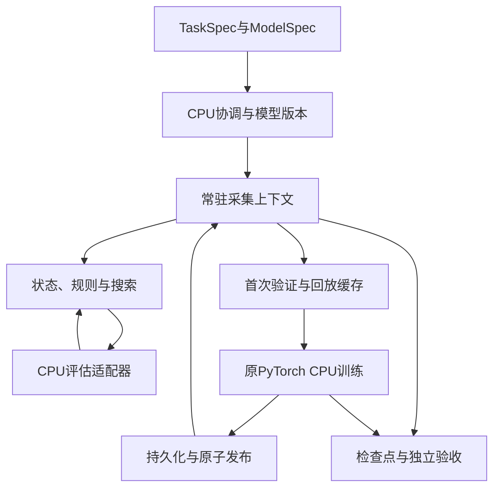
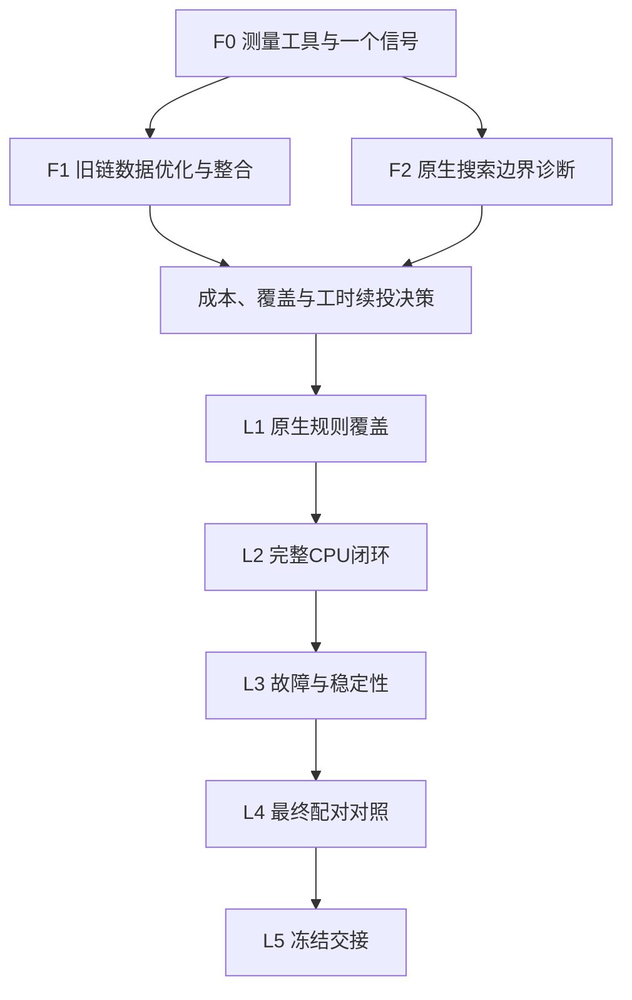

# CPU优先高吞吐运行时：总体架构与项目书 v0.2

日期：2026-10-22（北京时间）  
性质：终稿候选，待最终阻断评审。首期和后期的实现均尚未执行。

## 1. 项目决策与目标

本项目继续采用AlphaZero式学习闭环：P/V网络引导MCTS，执行真实游戏交互，收集完整对局，形成策略/价值目标，经回放和SGD产生新模型，发布后供真实后续采集使用。

本轮优化对象是完成这些工作的工程执行成本。先让无GPU的Codex CPU任务明显提速，再在独立GPU项目中复用成果。长期完整闭环100倍目标保留；本轮不重议学习路线，不以更简单地图、更少搜索或漏做训练换速度。

批准建议仅限首期三个任务：F0现场成本工具与一个优化信号，F1旧Runner数据/生命周期改造及一代整合验收，F2原生连续100模拟的边界诊断。完整规则重写、新事务系统、GPU后端暂不投入。

实际开工条件是终稿最终评审完成、项目负责人处理阻断项、用户启动对应Codex任务。本次发布没有启动任务。

## 2. 已知背景与证据分级

魔塔是确定性单人资源规划游戏。对象交互顺序影响属性、战损、资源及未来可达性；价值回传不逐层翻号。合法交互、自动事件顺序与首次Goal后的零动作是游戏合同。

P48的AutoDL完整训练闭环已通过，CPU工程组合两组外层墙钟产能约提高2.1倍，未证明学习能力提高。P49/P49.5的小塔实验提供闭环和部分迭代收益观察，本轮不重跑其网络架构比较或扩大地图。

### 2.1 历史实测锚点H48

| 指标 | baseline600 | candidate600 |
|---|---:|---:|
| 合格新位置 | 1932 | 4225 |
| 外层完整墙钟/秒 | 619.220 | 642.755 |
| 合格位置/秒 | 3.120 | 6.573 |
| 相对历史baseline600 | 1 | 2.1068 |
| 模型更新 | 3 | 7 |
| SGD步数 | 208 | 486 |

反向300秒重复约2.058倍。候选单位CPU成本增加约10%，另一重复约20%，说明既有收益主要来自增加有效用核，未消除大量单位位置工作。

历史机器记录约20核CPU配额、约90GiB内存和一张4090；胜出组合主要在CPU上运行。可见208逻辑CPU不等于208核配额，以上资源也不是当前Codex环境规格。

公开`perf/patches.py::Profile`使用`time.perf_counter()`，记录互斥同步作用域的壁钟线索。不得把其中规则、编码、forward、save桶直接称为实测CPU核秒。总CPU核秒应另测。嵌套计时、worker重叠和父future等待不能重复相加。

参考文档与证据见[BASELINE](../../review/20261022/BASELINE.md)、[MEASUREMENTS](../../review/20261022/evidence/p48/MEASUREMENTS.json)。公开摘要能重算不等于持有原云端全部episode和权重。

### 2.2 设计启发的地位

此前本地检查提示紧凑观测、原生BFS和固定索引组批可行，也暴露Python边界可能吞掉内核收益。这些检查未随本目录提供完整可复现输入和脚本，因此本终稿不拿其倍率作预算输入或里程碑PASS证据。F0/F2建立与当前决策直接相关的正式新证据，不机械重跑旧微测。

### 2.3 待测与主观估计

Codex实际配额、内存、旧程序成本、真实网络往返、原生覆盖收益和恢复成本均待现场测量。后文工时和倍率为规划，不是实测、置信区间或必然交付。

## 3. 范围、测试轨与收益分母

### 3.1 CPU与AutoDL解耦

规则、搜索、数据、发布和恢复不依赖AutoDL路径、凭据或CUDA。CPU实现能够在普通Linux多核环境安装、运行与验收。GPU未来替换推理/训练设备后端，不重写游戏和账本。

### 3.2 两条具体兼容轨

| 轨道 | 首期用途 | 模型与任务边界 |
|---|---|---|
| R48十层参照 | 公平性能工作负载、原生边界与规则覆盖依据 | 冻结十层任务、550×13×13观测和713动作CNN，仅此适配器使用旧接口 |
| T49对象拓扑 | 保证公共边界支持当前对象图方向 | 直接对象节点、两类关系、英雄状态、21动作关系网络；首期固定形状 |

T49公开实现位于`tasks/tower10/p49/topology/`。首期沿用该已读来源；若实施任务使用更新的私有P49.5，Codex先核对确切提交和接口并记录差异，未取得源码不声称已兼容。无须用户重复项目背景，也不要求先公开新私有代码。

`controlled/`的拓扑容器CNN不能代替T49。首期不建设任意变长图平台，不补零改变池化，不训练新网络。R48内部历史图保留必要CSR/路径语义，不把它规定为T49网络输入。

F1中T49只验证样本身份、原输入字节和真实关系模型前向；后期完整CPU闭环再验T49真实N0→N1及新模型消费，复用现有对象规则，不同时移植第二套引擎。

### 3.3 三个分母

- H48：历史AutoDL性能锚点，只作历史桥接。
- C0：同Codex现场原串行程序，完整任务/模型/预算合同固定。
- Cbest：同现场可用的既有CPU工程候选，防止把已经完成的优化重新申报。

正式CPU倍率为`rate_new / rate_C0`，同时报告`rate_new / rate_Cbest`。Codex新速率除以历史H48只叫历史比值，不能称同机加速。C0必须包括真实训练/发布/回流；F0微测或未触发训练的短校准不叫完整C0。

历史权重不全时用一个共同的新随机N0模板和冻结种子创建新配对run，记录身份，不冒称历史复现。

## 4. 总体运行架构

首期D可仍使用旧规则/Search；F2单独比较原生树混合诊断臂和有限全原生候选臂。图是目标职责划分，不代表首期一次重写全部模块。

### 4.1 静态数据与动态状态

地图/对象定义、战斗规则、事件程序、动作映射和关系索引装载一次并绑定身份。动态状态保留全部影响规则和观测的字段，包括资源、方向、对象生命周期、障碍、商店计数、flags和必要历史。

原生实现优先轻量C++扩展和紧凑状态复制；Rust如实际更合适可提出有依据替代。绑定形式由F2冻结。工具链探测是实现输入，不能仅缺cargo就否决C++，也不自动改投多个新技术栈。

先用简单可验证的驻留结构，测出复制瓶颈后再做make/unmake。搜索内部减少仅为人类展示而生成的路线列表、JSON和事务说明，但真实路径结算、途中自动事件、方向及跨楼语义仍计算。真实交互和独立验收能够导出需要的路线/结算证据。

### 4.2 搜索执行边界

原生树保存边N/W、子树、继承访问和待决上下文。一个真实决策连续完成规定的100新增模拟。仅叶节点评估交换紧凑请求，不反复把完整世界转换为Python字典。

先保持单树串行PUCT、原根噪声与动作选择、同模型同局树复用；跨独立局可按原逻辑cohort执行。不合并不同路径的树N/W为状态DAG，不增加virtual loss，不注入路线或穷举答案。

混合诊断臂明确是“原生树＋旧Python规则”，回调成本全部计入。它是有效诊断成果，但不是全原生规则认证。全原生候选出现UNSUPPORTED时停止该决策，不在臂内偷偷回退；需比较混合臂时从同一初始上下文独立执行。

### 4.3 CPU推理与窄模型接口

第一版常驻原PyTorch CPU模型，优先进程内调用。模型按model_id装载与切换，原始网络函数、权重、输入信息、dtype及输出动作映射不变。服务/RPC、导出后端或编译优化只有测量显示值得时才另做任务；接口预留不等于提前实现GPU服务。

原网络已使用inference_mode，已有P/V缓存，既有进程池也常驻。不能把这些当新增收益。仍有每episode构造Runner/模型/优化器和重载快照的机会，需在实际生命周期核对，而不是通过重复model.eval()推测。

ModelSpec最少描述：模型工厂及schema身份、命名输入的dtype/shape/轴/封套、稳定动作顺序、logits/value形状和价值语义；每次发布另绑定weight_hash。TaskSpec/Recipe保存规则、资产、奖励、搜索和训练合同。

R48适配器保持`[B,550,13,13]`与713动作。T49保持节点`[B,21,27]`、关系`[B,2,21,21]`、英雄`[B,7]`，可继续使用原`[B,21,76]`封套；若拆分调用，必须与原封套前向对照。R48的BN与T49的LayerNorm/均值池化分别保持。

F0先测batch1；仅有明确供给/容量问题时测batch2/4。跨独立树合批与同树叶并发不同，前者不必自动归为改变搜索协议，后者会影响树统计。实际使用共享服务才验队列、背压、超时和排空，不为架构外观强加RPC。

首层线性分解仅作未来等函数推理候选。全局广播特征可用权重相关基函数表达，不能因每格都变就断言不可预计算；反之也不能因输入稀疏就预设收益。权重变化需失效，浮点重排需数值门禁，脱离autograd的推理缓存不能直接用于训练。

### 4.4 一次验证与ReplayStore

首期改造在旧Runner中进行。每个完整episode首次入库时由旧环境验证来源、规则、终局及目标，证书绑定内容、规则、schema和验证器版本。不可变内容变化时拒绝复用；不能仅凭旧文件名信任新内容。

以`episode内容身份＋record索引＋schema/规则/验证版本`形成稳定sample_id。缓存X、合法mask、pi和最终z，保留原回放顺序与uniform-with-replacement抽样。缓存只读、限额、可淘汰和重建，不能改变RNG或挑容易缓存的样本。

缺完整终局的前缀可用于观测/规则/推理，不可伪造z用作训练验收。F1先取得真实完整episode，对100批固定draw比较输入目标，再让新缓存进入真实训练。无需保留全部batch在内存。

历史R48完整dense窗口约2.84GiB只是参考；缓存上限由实际Codex配额、模型和树内存决定。淘汰、首次构建、重启重建都计时。不建设耐久缓存数据库。

### 4.5 协调、训练与发布

首期保留逻辑四局cohort、同代训练屏障、原随机流与提交顺序。物理worker数由配额设定，避免actor线程与推理/训练线程过度订阅。并发数不自动等于忙核。

训练保持原配方，包括batch、lr、momentum、手工L2作用范围、norm行为、触发、抽样及样本曝光。到期步数按本次实际触发样本n计算，不因预算紧缩减。

新模型先保存完整工件和父子训练身份，再原子发布可见model_id。请求、样本与回复绑定模型版本；切代后不兼容树/权重缓存失效。真实发布后至少有一个用新权重完成的真实决策证明回流，不能只检查模型文件存在。

未来较多actor、模型滞后、异步或不同精度不被永久禁止，但不自动混入首期严格对照。根据首期证据另写ADR和配对验收，不以“超过10倍必改协议”等未证上限限制设计。

### 4.6 持久化与恢复顺序

F1复用旧检查点和提交边界，只把派生缓存做成可重建。F2原型要求完整动态状态、树、待决上下文和RNG导出/重建，不要求生产事务恢复，也不承担正式训练产能。

原生进入真实生产闭环前实现最小正常停止/恢复，优先紧凑完整快照＋不可变已发布模型引用。训练中的参数、norm缓冲、优化器动量不断变化，必须保存当前训练状态，不能只引用上代模型。

只有实测完整快照序列化/写入/恢复仍是显著瓶颈，才立新WAL任务，明确树统计、SGD、RNG及幂等重放协议。F1不预先实施WAL，不通过降低审计频率删除必要首次验证。

已提交样本不丢、不重计，已提交训练步不跳过或重复提交；未提交重算量显式标明。沿用旧恢复窗口的严格结果与扩大窗口的变体单列。

R48原搜索检查间隔400、新增预算100，T49检查间隔100，另有每决策与每SGD保存；不能以笼统“每决策存盘”掩盖中途暂停差异。正常预算停止允许保留部分搜索，但不计完整决策；恢复需继续剩余模拟。

最终性能结论前验决策、SGD、发布边界的进程故障与不完整工件。文件/目录持久顺序按实际修改检查；进程kill不等于断电测试。首期不要求全机断电模拟，不声称旧JSON/episode的replace已提供整组工件断电一致性。

## 5. 身份、正确性与数值合同

规则状态身份、观测身份、模型身份分别管理。相同网络输入不证明相同后续规则。快速hash是索引，生产使用完整相关键和碰撞验证；不能用资源分桶、只用64位值或遗漏t来构造近似缓存。

`state_id`等现有函数的排除字段及成本必须实际核对。旧`common.digest`为canonical JSON的SHA256；不能预设其成本50微秒，或不测就宣称换键能快9%。

新实现有独立engine/source身份并记录兼容关系；保留旧源不变，不能删hash保护后仍称冻结参考实现。

| 层面 | 主要硬门禁 |
|---|---|
| 规则 | 整数资源、对象/flags/task、完整合法集及顺序、拒绝、自动事件、终止精确一致 |
| 数据 | 无损封套/缓存X、mask、pi、z及抽样索引逐字节相同；内容改变拒绝复用 |
| 搜索 | 同固定oracle、噪声、RNG、继承树下逐模拟比较选择、扩展、回传、N/W、pi及100新增预算 |
| 网络 | 同后端原样调用要求一致；换后端/运算顺序先登记abs/rel容差和决策分叉处理，不以任意bit-exact规模代替数值合同 |
| 训练 | 同draw输入、损失、norm、动量、有效梯度及参数变化；到期SGD完成，新模型确被消费 |
| 恢复 | 对提交边界的完整状态与账本核对；不把重复重算计为新位置 |

建议网络容差起点abs1e-5/rel1e-4，最终按具体后端跑前冻结；不得事后为通过放宽。接近并列导致搜索分叉需记录并诊断；规则差异不能按浮点容差放过。

旧`validate_episode(reference=True)`只切mask，step仍取传入env，因此不足以独立认证新转移。参考端必须实际调用保存原样的旧环境/旧step，新端独立计算；不能两个包装共用新内核。

源码/任务不存在的机制据规则标N/A；存在的全部支持范围必须认证，不能用“50%/80%机制覆盖”直接允许完整生产任务。随机调用数不代替正向、边界、拒绝和机制组合覆盖。

## 6. 性能模型与预期收益

### 6.1 可测变量及单位

| 变量 | 定义 | 说明 |
|---|---|---|
| N、T | 合格新位置数、完整外层秒 | 含初始化、训练、发布、必要验证及收尾 |
| C_total | 所有参与进程累计CPU秒 | 进程树/cgroup采集，防重复计同一进程 |
| c=C_total/N | CPU秒/合格位置 | 与wall桶分开 |
| C_eff=C_total/T | 全过程平均忙核 | 已包含阶段和等待影响，不再乘利用率d |
| a、q、l | 活跃独立树数、每决策真实评估行数、独立调用完整wall延迟 | 同时注明q每决策/每合格位置，不能混分母 |
| 各阶段wall与CPU | 采集、训练、保存、验证、尾部、冷构建 | wall重叠单列，不把相加内核时间当总墙钟 |
| 内存/I/O | 峰值RSS、缓存大小、写入/IPC字节、恢复重算 | 内存和线程服从实际配额 |

恒等式`N/T = C_eff/c`只说明同一组计数自洽，不是两个独立证据验证预测。预测需要可实现的单位降本、忙核与串行依赖；有效忙核不能取物理核数或actor数直接代入。

每树串行独立评估时，采集活跃期间条件容量约`a/(q*l)`；转为合格位置/完整墙钟还要考虑完整局提交、训练屏障、保存和尾部。共享合批需另测真实批供给、服务吞吐和排队，不能再乘一个理想batch系数。

历史约0.06699秒/完整位置的搜索推理、四actor、其他工作全忽略时，条件容量约59.7位置/秒，即H48约19.1倍。它是旧推理条件下的容量说明，不是“只优化forward的收益”，不是同Codex倍率，也不是所有CPU实现上限。

### 6.2 项目负责人的规划判断

| 场景 | 相对同现场C0的主观累计预期 | 关键条件 |
|---|---:|---|
| 受限资源/推理或冷启动主导 | 可能约2—5倍或更低 | 少核、低内存、数据改造覆盖成本有限 |
| 首版完整CPU运行时 | 5—12倍，中心8—10倍 | 约4个或以上实际可用核、受限缓存可用、宿主降本、原学习合同与训练回流保持 |
| 进阶条件目标 | 12—20倍 | 原生边界与CPU评估延迟均已验证改善，训练/快照无新瓶颈 |
| 上行情景 | 20—30倍或更高 | 更深入执行/等函数后端或明确调度变体；按合同分列实测 |

这些数字不是各阶段乘数。首期F0—F2只负责产生工具、可运行优化和判别证据，不承诺完成首版整体区间。F1不预注册必达3倍、F2不以微测5倍作硬正确性。

Claude最终预测偏向4—6倍，Qwen偏向首版中心8—10倍。我们不平均两个数：采用后者作为待更新投入假设，同时保留低档风险，不接受任一报告推断出的永久“严格版本最多15倍”等上限。

10倍是挑战目标，20倍是进阶目标；低于目标但正确且节省等待/核秒的版本可有价值。必须如实区分功能PASS、性能结果和续投决策。

### 6.3 续投方法

首期后用一份证据表说明：剩余热点、该次拟迁移范围占比f、实际降本k、额外边界/快照成本delta、支持覆盖、工程工时及复用价值。

同工作、同忙核条件下的单位CPU降本估计可用`1/(1-f+f/k+delta)`，但只有f和k范围匹配才代入；不把成功子集的k代表整个任务。1.5倍可作建议经济信号，不是硬技术门槛。缺f或代表性时给区间/未测，不编整链预测。

F1低收益可能说明规则/树值得继续；F2低墙钟收益但降核秒也可能值得。若主要瓶颈已经是推理/SGD/存盘，改投对应便宜路径。规则不正确或边界反复吞没收益且无廉价修复时暂停扩展。

## 7. 首期和后期计划

详细任务见[TASKS.md](TASKS.md)。

F1/F2技术上独立，默认按单会话单任务串行派发；不自动启动多Agent或同时占多份资源。L2之前已有正常停止/恢复，L3不是事后才补基本恢复。若续投选择推理/快照等替代方向，用ADR调整L1范围和依赖，仍保留L2—L5门禁。

用户所说“一周量”视为首周期规划尺度。F0开发2—4小时、F1任务包8—12小时、F2任务包8—16小时，首期18—32小时是时间盒规划，不是保证完成闭合全原生切片或一代整合。可以按明确子交付拆会话，到期PARTIAL交接，不压缩门禁。

后期完整认证工作量仍以多周量级估计，先不冻结十多个会话。首期结束根据真实速度估算，避免用AI辅助比例或没有数据的完成概率承诺日历日期。

## 8. 预算、停止和计数合同

开发时间为会话墙钟，含阅读、构建、修复和等待测试；测试墙钟是其中子集，不重复相加。资源用量另报CPU核分钟，不能称“CPU分钟”而混用。

F0测试≤8分钟，其中必要参考夹具生成≤90秒；F1初始测试≤20分钟；F2初始测试≤15分钟。首期初始测试总上限43墙钟分钟。任何一次任务启动只授其自身预算；不足时保存并交接，下一次任务可重新冻结剩余预算，不自动连续执行。

R48每次真实触发n条新位置后应做`ceil(8*n/64)`步；未达512触发阈值的尾部不算已到期债务，已触发的不允许取消。T49用自己的冻结64位置触发配方。完整对局/cohort允许超过阈值，不能在恰好512位置截断对局。

真实在线停止：停止接新工作，在原安全边界保存，部分搜索/在途局不伪装为完整新位置；已触发SGD在尾部预算内结清，未结清明确INCONCLUSIVE。日志中分开主窗口、尾部、暂停、债务和未触发尾部。

最初的一代整合C0/F1共两臂，用于F1整合和成本证据，来源/合同未变时可复用，不另建M0b研究任务。它不是最终AB/BA。

最终AB/BA总共四臂：C0、新版本；新版本、C0。每臂600秒工作窗口，初始化/必要验证/尾部计入外层，每臂总外层≤900秒，四臂总外层≤3600秒。四个600秒是40分钟工作切片，不是一小时连续稳定测试。超时不是缩训练门槛的理由。

固定工作块、额外Cbest、较长稳定试验另列预算；Cbest无有效同现场完整证据时，两臂可另预登记最坏30分钟，不以F0微测替代。最终四臂应在统一现场条件重测，旧F1证据只复用功能和辅助成本，不替代最终版本对照。

## 9. 正式验收与项目状态

主指标：已提交合格新位置/完整外层墙钟。失败终局合法数据照计；在途、重复恢复、离线oracle、独立评价不混入。公开P48最终全为无交互失败并不否定工程产能，但不能证明学会任务。

每臂记录源/配置/资源、初始化、采集、训练、保存、验证、收尾、位置、episode、决策、新增模拟、推理与cache、到期/已做SGD、发布与消费、内存、I/O、CPU核秒、异常和所有失败。

规则/学习合同错为FAIL；证据或预算不足为PARTIAL/INCONCLUSIVE。功能通过而低于10倍，写“功能PASS，未达挑战目标”，保留全部结果及投入判断；不把接口通过写成学习收益，也不把一次微测写成一小时稳定产能。

较长稳定性根据现场填满缓存/回放窗口、完成若干代和资源趋势来设，先预登记具体时间；不把任意“十种子×1800秒”自动列为必做，也不在未过覆盖与恢复前大规模试跑。

## 10. 来源、发布和后续GPU

公开参考源码：`tasks/tower10/p45/`、`tasks/tower10/neural/vendor/`、`perf/`、`tasks/tower10/p49/topology/`。原审查包见[入口](../../review/20261022/README.md)。

两份第二轮回复是本次综合输入，原报告全文未在本目录公开；[REVIEW_DECISIONS](REVIEW_DECISIONS.md)记录取舍与可核对源码，不把评审者自称“实测”的未测推算直接继承为事实。

本项目书和沟通资料在`hydeful/mota-runtime`公开。后续实施默认私有`hydeful/mota-project`独立CPU分支；用户启动具体任务时明确分支。若未指定，采用新建不冲突CPU任务分支，不合并main，不擅自公开私有代码/权重/路线数据。文档公开不等于私有工程公开授权。

每项交付代码、命令、原始结果、环境/来源、首次失败修复、未完成项、固定提交和远端读回证据。最终审查通过后也只逐项启动，不连续自动跑完整路线图。

未来GPU仅替换Eval/Learner设备实现并优化数据放置，沿用任务、规则、搜索、样本和账本。CPU阶段不实现CUDA专项、不远程部署。长期100倍的约312合格位置/秒及约1.56万评估行/秒、平均39步SGD/秒仅为历史密度下容量参考，GPU阶段独立实测，不能把CPU与GPU局部倍率直接相乘。
