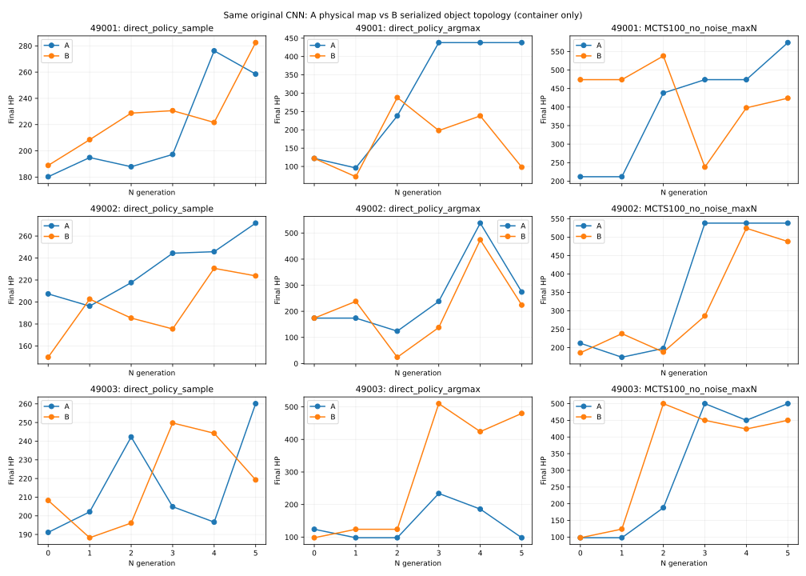

# P49受控CNN对照：结果与结论

**完整完成。** 三对固定经验拟合均各56步；三对A/B在线链均完成N0→N5及重载N5后的4局真实采集。正式计算及本地报告751.647秒，864局评价完整成功，无异常/合法失败/未完成。
A为原地图输入；B为“对象拓扑序列化＋原CNN”。B的34×5×9只是1456个完整拓扑数值加74个零的容器，不是物理地图。

## 1. 原CNN能否在完整拓扑编码上学习？

本协议中观察到实际拟合和直接策略采样收益。B三对的训练池、保留集CE/KL及价值MSE均较第0步下降，训练池最终价值MSE三对均低于训练均值常数基线；在线直接采样N5均高于N0。
这些结论来自真实损失/误差与游戏HP变化，不以梯度非零或通关率代替。B保留集价值MSE只有一对优于固定常数，MCTS100还有一对退化，因此不能称为各指标稳定改善。

## 2. 同数据、同初态、同SGD的拟合比较

44局801真实训练位置、8局139保留位置。配对初态完整state_dict hash（含BN）一致，参数签名及123994参数相同，56×64样本索引逐项一致。A/B仅按冻结输入编码及对应环境表示不同。
第56步，训练CE为B两对较低、A一对较低；训练价值MSE为A两对较低、B一对较低。保留CE三对均为A较低；保留价值MSE为A两对较低、B一对较低。没有一种条件在所有拟合指标上都占优。
训练均值常数预测器：训练MSE=0.02102256，保留MSE=0.02549257。A保留价值MSE三对均优于该常数；B仅49003优于常数。保留集不是新地图或保证未见状态。

|seed|训练CE A/B|训练MSE A/B|保留CE A/B|保留MSE A/B|保留ΔCE B−A|保留ΔMSE B−A|B保留预测均值±标准差|
|---|---|---|---|---|---:|---:|---|
|49001|1.316917/1.318679|0.015960/0.017090|1.348630/1.356019|0.022865/0.027902|+0.007389|+0.005037|0.322078±0.042592|
|49002|1.319763/1.316065|0.017244/0.016510|1.357836/1.358334|0.023546/0.026010|+0.000498|+0.002464|0.332258±0.041983|
|49003|1.317011/1.315619|0.017523/0.020336|1.351964/1.356453|0.023955/0.023789|+0.004488|-0.000166|0.272144±0.052605|

固定经验游戏评价也并非所有指标同向：B／49001直接采样188.875→209.375，argmax122→348，MCTS100却474→448；所有三对第0/56步成绩在完整表保留。
[所有0/10/27/37/47/56步及拟合曲线](REPORT.md)；[全部配对差值](paired_differences.json)。

## 3. 同学习规则的五轮闭环收益

直接采样：A和B三对均有N5−N0正收益，幅度不同且中间代数波动。MCTS100：A三对均提高，B两对提高、一对下降。argmax：A两对提高、一对下降；B两对提高、一对下降。
N5配对比较：直接采样B一对高于A、两对低于A；MCTS100三对均A较高。此为三对小规模观察，不能宣称普遍架构优势。

|seed|输入|直接采样16局均值 N0→N5|变化|argmax一局 N0→N5|MCTS100一局 N0→N5|MCTS变化|
|---|---|---|---:|---|---|---:|
|49001|A|180.250→258.500|+78.250|122→438|212→574|+362|
|49001|B|188.875→282.500|+93.625|122→98|474→424|-50|
|49002|A|207.375→271.750|+64.375|174→274|212→538|+326|
|49002|B|149.750→223.750|+74.000|174→224|186→488|+302|
|49003|A|191.125→260.125|+69.000|124→98|98→500|+402|
|49003|B|208.250→219.250|+11.000|98→480|98→450|+352|

六条在线链分别产生425/385/420/405/424/444个真实训练位置，56/50/55/53/56/57步SGD，合计2503位置、327步。阶段一另有336步，正式总663步SGD。六条链另有24局重载回流、451位置，无N6。
线上经验和应做SGD不同是输入影响动作后的传播结果，未抹平；阶段一用于控制经验与更新量，阶段二用于观察整个同规则闭环，不能合并成单一因果结论。

## 4. 已解释和仍未解释的差异

已控制：A/B同一CNN类及原P45 forward/Block、参数/BN初态、阶段一同经验/同batch/同SGD。B三对出现实际拟合和采样收益，表明本编码与原CNN组合在该协议下可以学习。历史关系网络实验的退化原因仍未确定。
环境实现保留不同：A为原物理图/加速索引，B为已认证对象图及原规则事务代码。复用原76849状态/266443转移等价依据，本轮只检查940个既有真实轨迹位置的新边界，没有重跑整图认证。
仍未解释：为何B／49001在直接采样均值提高时，argmax与MCTS100最终下降；输入编码的卷积邻近假设、价值/策略拟合与搜索分叉如何共同影响该现象。本轮不做追加消融或参数扫描，也不预判原因。
节点编号固定，B不具备节点重排不变性；只验证冻结P49。不同初态权重虽在每对内完全匹配，编码会使未训练网络输出不同，N0成绩无需相同。三对结果不是普遍表示或图网络优势证明。

### 已有轨迹的资源分叉

原记录显示，采样轨迹拿剑前打法师曾损348HP；拿剑后出现48或88HP，具体与当时资源状态对应。完整事件、先验/价值/Q及真实资源变化见后验记录，未用于训练提示。
|seed|输入|代数|MCTS HP|药水增HP|总战损|零战损史莱姆/总史莱姆|
|---|---|---:|---:|---:|---:|---|
|49001|A|N0|212|300|488|0/3|
|49001|A|N5|574|500|326|3/4|
|49001|B|N0|474|500|426|2/4|
|49001|B|N5|424|400|376|0/2|
|49002|A|N0|212|250|438|0/2|
|49002|A|N5|538|500|362|3/4|
|49002|B|N0|186|200|414|0/1|
|49002|B|N5|488|500|412|2/4|
|49003|A|N0|98|0|302|0/1|
|49003|A|N5|500|500|400|1/4|
|49003|B|N0|98|0|302|0/1|
|49003|B|N5|450|500|450|0/4|

例如A／49001的N5完整领取4瓶补给，并有3场史莱姆零战损；B／49001的N5只领取2瓶补给，史莱姆零战损场次为0。HP收支可解释这些路线的分差，不能据此断言优化器或编码退化的根因。
[后验完整表](POSTHOC.md)及[逐动作资源/Q记录](POSTHOC.json)只读已有正式轨迹，没有新增游戏。

## 核验、耗时和证据

接口、固定经验控制和六条闭环核对通过。864评价（固定经验216＋在线648）全部成功；12个worker无异常；24个跨条件/跨阶段模型加载负例全部拒绝。首个正式SGD有限性、三组梯度、BN计数、参数变化与保存重载均核验；完整优化器/RNG检查点保留。
正式751.647秒，其中本地图表/报告约3.38秒；开发/接口至冻结启动815.858秒，独立短局预检的实际计时见PREFLIGHT.json。细分文件时间界限与归档/上传/读回计时见TASK_TIMING及交付回执。B启用额外profile，因此本轮耗时不用于公平性能比较。
冻结执行源码提交8073025dc9ce94727baf3d12ca5c8df3bcd30ac8。旧地图/旧关系网络共192个交付文件SHA未变。源码快照无.git，以远端固定提交与归档执行源SHA为准。
[协议](CONTROLLED_PLAN.md) · [配置A](config_A.json) · [配置B](config_B.json) · [适配](ADAPTATION.md) · [首次失败](FIRST_FAILURES.md) · [独立核验](EXTRA_VALIDATION.json)。
完整原始数据、各步模型/优化器/RNG、模型父链、训练账本及执行源集中在[归档清单](artifacts/ARCHIVE.json)；[轻量汇总ZIP](artifacts/summary.zip)与权重/大样本分开。
下一步最应处理：只利用现有B／49001各代记录，核对根访问目标、策略先验和价值/Q在关键分叉上的变化，解释采样与确定性选择结果分离；本轮不追加计算实验。
