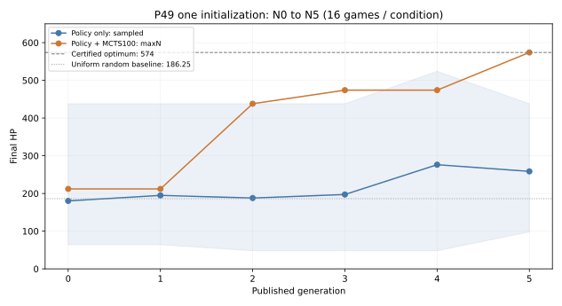

# P49地图输入网络＋对象交互搜索的5轮学习实验

地图、数值、初态和Goal未变。网络主体2个残差块×32通道，输入34×5×9，713输出中21个绑定对象、692个永久mask。
原P45 Runner源码原样在P49依赖命名空间执行；采集、SGD、回放、发布与恢复合同沿用，P45本身未修改。

## 三项独立结论

1. 接口：见ADAPTATION.md、interface.json与chain/first-formal-step.json；正式异常=None。
2. 闭环：N0→N5及重载N5后的4局回流完成=True；累计SGD=56步。
3. 学习收益：按以下全部六轮结果分别判断，不以参数变化或通关率代替学习证据。

|模型|直接策略均值|中位数|范围|最优比例|MCTS100均值|中位数|范围|最优比例|
|---|---:|---:|---|---:|---:|---:|---|---:|
|N0|180.25|163.0|64–438|0/16|212.00|212.0|212–212|0/16|
|N1|194.88|171.0|64–438|0/16|212.00|212.0|212–212|0/16|
|N2|187.88|176.0|48–438|0/16|438.00|438.0|438–438|0/16|
|N3|197.25|199.0|48–438|0/16|474.00|474.0|474–474|0/16|
|N4|276.25|255.0|48–524|0/16|474.00|474.0|474–474|0/16|
|N5|258.50|282.0|98–438|0/16|574.00|574.0|574–574|16/16|

阴影为逐局最小值至最大值，曲线为均值；全部逐局结果与决策记录保留在evaluation/。
直接策略按合法softmax分布采样；MCTS100无根噪声、maxN，确定性引擎与固定权重下16个seed可能产生相同路线，不能当16条独立随机路线解释。

- direct_policy_sample：N0=180.25，N5=258.5，变化=78.25 HP。
- MCTS100_no_noise_maxN：N0=212，N5=574，变化=362 HP。

在本初始化、预登记的16局评价中观察到上述均值变化；它不是跨初始化稳定收益的统计证明，也不要求逐轮单调。

## 训练与模型回流

|更新|实际新局|实际新位置|应做/实做SGD|采集＋训练＋发布秒|
|---|---:|---:|---:|---:|
|N0→N1|4|78|10/10|7.380|
|N1→N2|8|130|17/17|11.928|
|N2→N3|4|75|10/10|7.232|
|N3→N4|4|73|10/10|7.871|
|N4→N5|4|69|9/9|7.275|

独立评价耗时90.187秒；训练阶段2.031秒。正式实验至汇总前138.693秒；含图表与收尾的最终墙钟见progress.json。
适配开发时间另列在ADAPTATION.md，不计入正式3600秒预算。

所有正式新局按原规则完整终止；没有复制位置或丢弃低分局。每轮在64个新位置后等4局cohort结束，SGD=ceil(8×本轮新位置/64)。优化器持续保留动量；回放窗口8192。
N5回流4局独立登记在N5-reflow.json，只验证重新加载后的权重消费，不触发N6。

## 证据与局限

- evaluation/*.jsonl.gz：六模型、两条件、全部逐局和逐决策结果，含模拟数与真实前向数。
- chain/episode-*.json.gz：全部正式采集轨迹、根访问标签及真实终局HP标签。
- chain/training-N*.json、first-formal-step.json：实际SGD账本、采样位置、数据梯度、损失和首次更新检查。
- chain/models.json、config.json、sources.json、schema.json：模型父链、权重hash、配置与源码身份。
- checkpoint与权重另列ARTIFACTS.json；异常/未完成不会生成失败标签。
- 正式运行进程安装读取guard，禁止旧行为与认证答案；最优值及随机基线只由本独立报告进程读取。
- 一条seed=49001学习链、每条件16局；不能推断跨初始化稳定性。

## 下一步

优先核查直接策略与MCTS根访问分布之间的差距。N5直接采样未取得最优路线且较N4回落；现有证据不足以将原因归结为训练量、损失或网络架构。本轮不追加实验。

## 拓扑架构边界

|层次|当前实现|
|---|---|
|规则与可达性|原拓扑引擎，根据对象、阻挡和资源状态执行|
|内部图|31个可通行格顶点及相邻有向边，仍含空地/走廊格|
|搜索动作|21个对象交互，空地/走廊不作为独立动作|
|网络输入|34×5×9二维地图特征，CNN策略/价值网络|
|人类展示|平面地图、坐标与路径回放|

因此，本轮应称为“P49地图输入网络＋对象交互搜索的5轮学习实验”。
当前方案来自任务设计允许地图输入和CNN的适配选项，不能归因于Codex擅自违背已明确要求。
本轮接口、闭环和剩血收益证据仅属于当前架构；它不是完整拓扑表征的学习验证，不能声称网络直接学会了拓扑关系图。

用户要求的后续目标是：内部计算、搜索和网络学习统一基于事件/对象节点及其连接、阻挡和资源条件；网络不接收二维网格；平面表示保留在展示、导出和回放层。
后续需要调整观测与网络输入、节点/关系批处理、对象策略映射、schema、P/V缓存键与checkpoint/样本恢复身份。
预计可以复用规则执行、有效对象交互、单人mean-Q PUCT、搜索访问标签、真实终局回报、SGD/回放/模型发布与评价统计。
仍需核查走廊收缩是否保留真实可达条件、入口/多路径及自动事件顺序，搜索状态身份和替换网络后的批处理/恢复合同是否完整。
本轮只记录边界，不实施新架构，不预先指定某一种图神经网络。当前收益不能代替目标架构的验证；若本轮没有收益也不能据此否定目标架构。

## 收尾核对

192局评价全部成功，合法失败/异常/未完成均为0。五轮训练共24局、425个真实新位置、56步SGD；N5另有4局重载回流，不触发N6。
两条件的逐局模拟数、真实前向数和耗时均在evaluation_summary.csv及原始评价记录中。
正式实验完整墙钟140.564秒。初版ARTIFACTS的progress.json身份因最终状态后写而过期，已保留首次旧清单并修复末尾清单时序；没有重训或重评。
本轮实际运行源码逐文件保存在executed_source/，对应sources.json和正式前固定提交9fe7b7fb28a08d69ed6f8e100e4ff3a8d35a8b25。
最终交付代码只增加归档时序修复和报告架构边界说明，未改地图、网络输入/结构、标签或实验条件。
