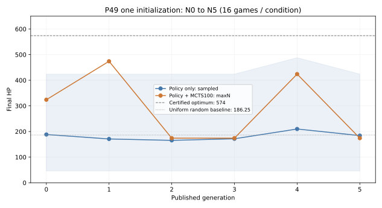

# P49对象拓扑输入关系网络的5轮学习实验

地图、数值、初态和Goal未变。网络输入21×27节点、2×21×21关系与7维勇士状态；2个32维关系消息块，21个对象策略输出。
原P45 Runner采集/训练/发布逻辑复用，仅两处mask/target数组长度从713绑定为21，P45原文件不修改；新权重和回放池独立。

## 三项独立结论

1. 接口：独立等价认证及接口核对通过；见ADAPTATION.md、CERTIFICATION.json、interface.json与chain/first-formal-step.json；正式异常0。
2. 闭环：N0→N5及重载N5后的4局回流完成=True；累计SGD=49步。
3. 学习收益：按以下全部六轮结果分别判断，不以参数变化或通关率代替学习证据。

|模型|直接策略均值|中位数|范围|最优比例|MCTS100均值|中位数|范围|最优比例|
|---|---:|---:|---|---:|---:|---:|---|---:|
|N0|188.25|164.0|46–424|0/16|324.00|324.0|324–324|0/16|
|N1|170.88|142.0|46–424|0/16|474.00|474.0|474–474|0/16|
|N2|165.38|142.0|46–424|0/16|174.00|174.0|174–174|0/16|
|N3|171.62|155.0|46–424|0/16|174.00|174.0|174–174|0/16|
|N4|209.75|181.0|46–488|0/16|424.00|424.0|424–424|0/16|
|N5|184.00|176.0|46–424|0/16|174.00|174.0|174–174|0/16|

阴影为逐局最小值至最大值，曲线为均值；全部逐局结果与决策记录保留在evaluation/。
直接策略按合法softmax分布采样；MCTS100无根噪声、maxN，确定性引擎与固定权重下16个seed可能产生相同路线，不能当16条独立随机路线解释。

- direct_policy_sample：N0=188.25，N5=184，变化=-4.25 HP。
- MCTS100_no_noise_maxN：N0=324，N5=174，变化=-150 HP。

最小闭环已跑通，学习收益尚未得到验证。

## 训练与模型回流

|更新|实际新局|实际新位置|应做/实做SGD|采集＋训练＋发布秒|
|---|---:|---:|---:|---:|
|N0→N1|4|78|10/10|21.164|
|N1→N2|4|71|9/9|20.239|
|N2→N3|4|68|9/9|21.744|
|N3→N4|4|84|11/11|26.027|
|N4→N5|4|75|10/10|26.381|

独立评价耗时215.058秒；训练阶段2.978秒。正式实验至汇总前353.555秒；含图表与收尾的最终墙钟见progress.json。
含报告收尾正式墙钟354.232秒；适配开发及认证1048.287秒另计，不计入正式3600秒预算。

所有正式新局按原规则完整终止；没有复制位置或丢弃低分局。每轮在64个新位置后等4局cohort结束，SGD=ceil(8×本轮新位置/64)。优化器持续保留动量；回放窗口8192。
N5回流4局独立登记在N5-reflow.json，只验证重新加载后的权重消费，不触发N6。

## 证据与局限

- evaluation/*.jsonl.gz：六模型、两条件、全部逐局和逐决策结果，含模拟数与真实前向数。
- chain/episode-*.json.gz：全部正式采集轨迹、根访问标签及真实终局HP标签。
- chain/training-N*.json、first-formal-step.json：实际SGD账本、采样位置、数据梯度、损失和首次更新检查。
- chain/models.json、config.json、sources.json、schema.json：模型父链、权重hash、配置与源码身份。
- checkpoint与权重另列ARTIFACTS.json；异常/未完成不会生成失败标签。
- 正式运行进程安装读取guard，禁止旧行为与认证答案；最优值及随机基线只由本独立报告进程读取。
- 一条seed=49001学习链、每条件16局；不能推断跨初始化稳定性。

## 拓扑架构与认证边界

运行时只有21个对象节点及直接连接，不含平面格顶点；规则资源条件由原P48内核执行。网络直接处理对象特征、关系和勇士状态，无二维网格、地图尺寸或原始坐标。
联合等价认证通过76849个可达约简状态和266443条转移；实际节点重排策略等变、价值不变；正式运行禁用格点函数的检查见progress.json。
认证限于冻结P49无走廊自动事件、楼梯和飞行的语义；不宣称任意十层自动事件已支持。
与地图CNN的网络结构、参数数量、归一化、动作头、观测及状态身份不同；seed相同不是相同初始化。本轮并列结果不能证明某种架构总体更强。

## 下一步

最有证据支持的下一步：仅利用已有采集与训练账本，检查同一批实际状态的根访问标签、策略拟合误差和终局价值误差随更新的变化，定位训练拟合与搜索选择之间的差距。本轮未执行该分析，不把任何原因预判为已证实；不追加N6、扫描或初始化。

本轮没有可定位的执行异常，完整六轮呈波动且N5低于N0，不能挑N1或N4代替最终结果，也不能据此否定拓扑架构。归档包含全部权重和原始轨迹；原地图版111个已交付文件SHA未变。

## 复查入口

逐局轻量表：evaluation_games.jsonl；完整决策与权重在artifacts/ARCHIVE.json列明的离线分块包。运行 `python tasks/tower10/p49/topology/results/seed49001/restore.py /workspace/p49-topology-restored` 可恢复并校验全部文件。
正式执行代码固定提交704878e6d801c9de8db8044f87766e32aff3b8b4，精确执行源快照在归档executed_source/。本报告收尾增加实际结论与入口，未修改已执行源码或冻结协议。
